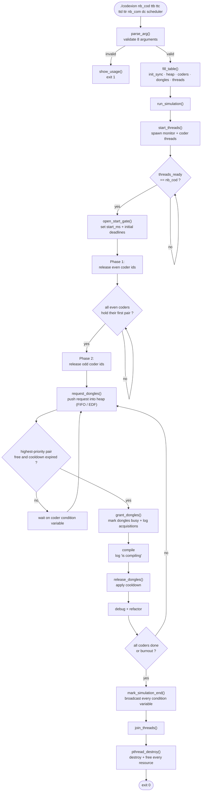
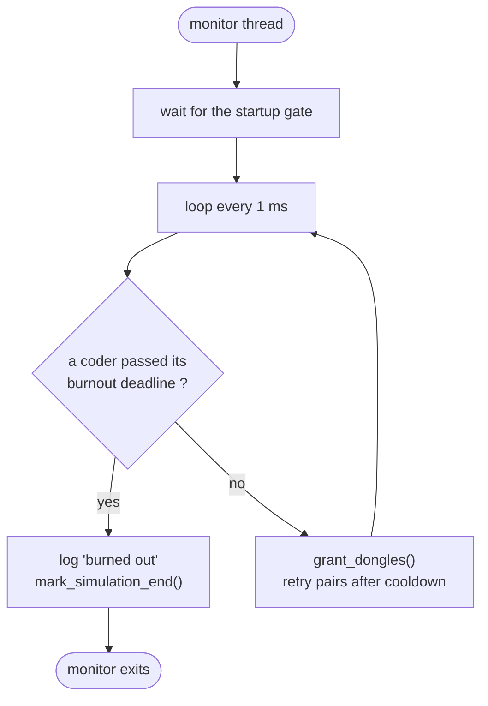
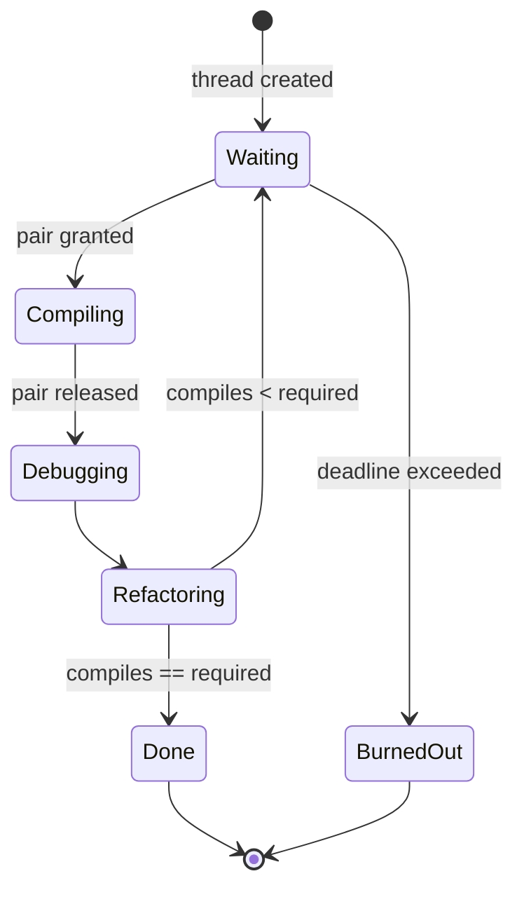

*This project has been created as part of the 42 curriculum by agalvan-.*

<!-- ASCII banner: ANSI Shadow font, same art style as the ft_malloc README. -->
<div align="center">
<pre>
 ██████╗ ██████╗ ██████╗ ███████╗██╗  ██╗██╗ ██████╗ ███╗   ██╗
██╔════╝██╔═══██╗██╔══██╗██╔════╝╚██╗██╔╝██║██╔═══██╗████╗  ██║
██║     ██║   ██║██║  ██║█████╗   ╚███╔╝ ██║██║   ██║██╔██╗ ██║
██║     ██║   ██║██║  ██║██╔══╝   ██╔██╗ ██║██║   ██║██║╚██╗██║
╚██████╗╚██████╔╝██████╔╝███████╗██╔╝ ██╗██║╚██████╔╝██║ ╚████║
 ╚═════╝ ╚═════╝ ╚═════╝ ╚══════╝╚═╝  ╚═╝╚═╝ ╚═════╝ ╚═╝  ╚═══╝
</pre>
</div>

# Codexion

Codexion is a concurrency simulation written in C. It is a variation of the
classic Dining Philosophers problem: several coders sit around a circular table,
share USB dongles, and must keep compiling before they burn out.

The program uses POSIX threads, mutexes and condition variables. It implements a
priority queue (binary heap) to arbitrate dongle requests with either a FIFO or
an EDF policy. Logs use ANSI colors, and a two-phase startup gate releases even
coder ids before odd ids once every thread has been created.

## Description

### The problem

A group of `number_of_coders` coders sits in a circle. There is one USB dongle
between each pair of neighbouring coders, so there are also
`number_of_coders` dongles.

A coder alternates between three activities:

1. **Compiling**: requires holding two dongles at the same time, one in each
   hand.
2. **Debugging**: holds no dongles.
3. **Refactoring**: holds no dongles.

After refactoring, the coder immediately tries to acquire two dongles and compile
again.

Every coder has a burnout deadline. If a coder does not *start* a new compilation
within `time_to_burnout` milliseconds from the start of its previous compilation
(or from the beginning of the simulation), it burns out and the simulation stops.

The simulation also stops successfully when every coder has compiled at least
`number_of_compiles_required` times.

### Goals

The implementation must:

- Prevent deadlocks while acquiring two shared dongles.
- Arbitrate dongles fairly according to the selected scheduler.
- Respect the mandatory dongle cooldown after each release.
- Detect burnout precisely and log it within 10 ms of the real burnout time.
- Serialize all log messages so two messages are never mixed on one line.
- Release every allocated resource when the simulation ends.

### Scheduling policies

The scheduler argument selects how waiting coders are ordered:

- **FIFO** (`fifo`): the coder whose request arrived first is served first.
- **EDF** (`edf`): the coder with the earliest burnout deadline is served first.
  The deadline is `last_compile_start + time_to_burnout`.

Both policies break ties by request time and then by coder id, so the result is
deterministic.

## Instructions

### Requirements

- A POSIX system with pthread support (Linux is recommended).
- `cc` and `make`.
- The 42 `norminette` tool is only needed to check coding style.

### Compilation

```sh
make             # build ./codexion
make re          # clean and rebuild
make clean       # remove object and dependency files
make fclean      # remove objects, dependencies and the binary
make test        # run the full test battery
make test-quick  # run functional tests without sanitizers or Valgrind
```

The Makefile uses `cc` and compiles with `-Wall -Wextra -Werror -pthread`.

### Execution

Direct execution:

```sh
./codexion number_of_coders time_to_burnout time_to_compile time_to_debug \
    time_to_refactor number_of_compiles_required dongle_cooldown scheduler
```

Or through the Makefile:

```sh
make native ARGS="3 1000 200 200 200 2 50 edf"
```

`make run` is also available. It preloads the author's `ft_malloc` library when
present, which is useful for 42 evaluations; `make native` runs the binary
without any preload.

### Arguments

All eight arguments are mandatory.

| Argument | Meaning | Valid values |
| --- | --- | --- |
| `number_of_coders` | Number of coder threads and dongles | Positive integer |
| `time_to_burnout` | Maximum time between compilation starts | Non-negative integer (ms) |
| `time_to_compile` | Duration of a compilation | Non-negative integer (ms) |
| `time_to_debug` | Duration of a debugging phase | Non-negative integer (ms) |
| `time_to_refactor` | Duration of a refactoring phase | Non-negative integer (ms) |
| `number_of_compiles_required` | Compilations needed from each coder | Positive integer |
| `dongle_cooldown` | Time a released dongle stays unavailable | Non-negative integer (ms) |
| `scheduler` | Dongle arbitration policy | Exactly `fifo` or `edf` |

Invalid input (missing arguments, non-integer values, negative values, zero
coders, zero required compiles or an unknown scheduler) is rejected with a usage
message.

### Examples

A small FIFO run:

```sh
./codexion 3 2000 100 100 100 5 50 fifo
```

The same run with EDF:

```sh
./codexion 3 2000 100 100 100 5 50 edf
```

A configuration that is intentionally not viable: only one coder is present, so
there is only one dongle, while compiling requires two. The coder burns out at
`time_to_burnout`.

```sh
./codexion 1 500 200 200 200 1 100 edf
```

### Exit status

- `0`: the simulation was started successfully. A burnout is a valid simulation
  result and also exits with `0`.
- `1`: invalid arguments or a failure while creating the threads.

### Log format

Each state change is printed as:

```text
timestamp_in_ms coder_id message
```

The possible messages are:

```text
timestamp_in_ms X has taken a dongle
timestamp_in_ms X is compiling
timestamp_in_ms X is debugging
timestamp_in_ms X is refactoring
timestamp_in_ms X burned out
```

Timestamps are relative to the start of the simulation. Every line is written by
a single thread while holding the logging mutex, so lines are never interleaved.

Each line is wrapped in an ANSI color sequence and reset with `\033[0m` before
the newline. Removing the escape sequences yields exactly the format above. The
color is derived only from the coder id, so every line belonging to a coder uses
the same color regardless of its state. The 256-color palette index is
`100 + (id * 37) % 132`, which gives up to 132 distinct coder colors before the
palette cycles. The timestamp is generated while the logging mutex is held, so
printed timestamps are monotonic.

## Project structure

```text
coders/
├── coders.h
├── algo/
│   ├── heap.h
│   ├── heap.c
│   └── heap_ops.c
├── core/
│   ├── codexion.c
│   ├── coder.c
│   ├── dongle_lock.c
│   ├── dongles.c
│   ├── log.c
│   ├── log_color.c
│   ├── monitor.c
│   ├── simulation.c
│   ├── start_gate.c
│   ├── state.c
│   └── time.c
├── init/
│   ├── init_coders.c
│   ├── init_dongles.c
│   ├── init_sync.c
│   └── init_threads.c
├── parse/
│   ├── display.c
│   ├── parse.c
│   └── parsing_utils.c
└── utils/
    └── free.c
tests/
└── test_battery.py
```

### Flowchart

The full program flow, from argument parsing to cleanup:



The monitor thread runs in parallel with the coder threads:



Coder lifecycle:



### `coders/coders.h`

The main header. It defines the shared data model and every public prototype:

- `t_state`: the lifecycle states of a coder.
- `t_dongle`: a dongle mutex, its busy flag and its cooldown timestamp.
- `t_coder`: coder identity, timing data, state, condition variable, its two
  dongle indexes and a pointer to the table.
- `t_table`: global simulation configuration, shared arrays, heap, startup-gate
  counters, synchronization primitives and cleanup accounting.

Keeping all shared types in one header makes the ownership rules explicit and
lets each module include only `../coders.h`.

### `coders/algo/heap.h`, `heap.c`, `heap_ops.c`

These files implement the priority queue used by both schedulers.

- `heap.c` creates, inspects and destroys the heap. It also implements `heap_pop`,
  which removes the highest-priority item and restores the heap property.
- `heap_ops.c` implements insertion and the two heap repairs (`bubble_up` and
  `bubble_down`). The comparison function switches between FIFO and EDF.
- `heap.h` contains the heap item structure, the scheduler enum and the module
  prototypes.

A binary heap was chosen because it gives `O(log n)` insertion and extraction
while keeping the scheduling policy explicit. C89 has no standard priority queue,
and the subject explicitly requires one.

### `coders/parse/parse.c`

Validates the command line. It checks the argument count, that numeric values are
valid integers within the accepted ranges, and that the scheduler is exactly
`fifo` or `edf`. On success it allocates and zeroes the `t_table` before passing
it to `fill_table`.

### `coders/parse/parsing_utils.c`

Contains `str_to_int`, which rejects empty strings, non-digit characters and
integer overflow, and `fill_table`, which copies the arguments into the table and
initializes the simulation modules.

### `coders/parse/display.c`

Prints the usage message to standard error whenever the arguments are invalid.

### `coders/init/init_sync.c`

Initializes the two global mutexes (`pool_mutex` for the simulation state and
`log_mutex` for output) and the global `start_cond` used by the startup gate. It
records which primitives were initialized so cleanup can safely destroy only
valid objects.

### `coders/init/init_coders.c`

Allocates the coder array, fills each coder and initializes its condition
variable. It records how many condition variables were created successfully.
Each coder receives:

- an id from `1` to `number_of_coders`;
- left dongle index `i`;
- right dongle index `(i + 1) % number_of_coders`.

For one coder this means both indexes are `0`, which is handled explicitly because
a single dongle cannot satisfy a two-dongle compilation.

### `coders/init/init_dongles.c`

Allocates one `t_dongle` per coder, initializes every dongle mutex and records how
many were initialized successfully.

### `coders/init/init_threads.c`

Creates the thread array and manages the thread lifecycle:

- `spawn_coders` creates one coder thread per coder.
- `start_threads` starts the monitor first, creates every coder and then opens
  the startup gate. The gate sets `start_ms` and the initial deadlines only when
  all coder threads report that they are ready.
- `join_threads` joins every coder, signals the monitor to stop and joins it.

If a thread creation fails, the simulation is ended immediately, already-created
threads are joined and the error is reported.

### `coders/core/codexion.c`

The program entry point. It parses the arguments, runs the simulation, performs
the full cleanup and returns the appropriate exit status.

### `coders/core/time.c`

`now_ms` returns the current time in milliseconds using `gettimeofday`.
`sleep_ms` waits for a requested duration in 1 ms steps while checking whether the
simulation has ended. This makes a burnout or a completion stop the sleepers
quickly instead of leaving threads blocked for a full compile/debug/refactor
duration.

### `coders/core/state.c`

`enter_state` changes a coder's state and logs the corresponding message while
holding `pool_mutex`. Doing both atomically prevents a state from changing after
the simulation has ended but before its message is printed.

### `coders/core/dongle_lock.c`

Provides `lock_pair` and `unlock_pair`. The two dongle mutexes are always acquired
in increasing index order to keep a deterministic lock order. The pair is locked
while `pool_mutex` is already held, so pair reservation is atomic and no other
coder can observe a half-reserved pair.

### `coders/core/dongles.c`

The heart of resource arbitration:

- `request_dongles` records the request time and EDF deadline, inserts the coder
  into the wait heap, tries to grant dongles and then waits on its condition
  variable.
- `grant_dongles` grants pairs atomically. It repeatedly looks at the
  highest-priority coder. If both dongles are free and their cooldown has expired,
  it marks them busy, pops the coder from the heap, updates the coder's deadline
  and state, logs the two dongle acquisitions and broadcasts the coder's
  condition variable. If the
  highest-priority coder cannot be served, lower-priority coders wait, preserving
  scheduler order.
- `release_dongles` marks both dongles free, applies the cooldown and immediately
  offers the scheduler a chance to grant the next pair.
- `wait_for_pair` handles the condition-variable wait and the race where a pair is
  granted at the same moment as the simulation ends.

### `coders/core/monitor.c`

The dedicated monitor thread required by the subject. Every millisecond it:

1. Waits until the startup gate has initialized the simulation times.
2. Checks whether a coder has exceeded its burnout deadline.
3. Marks the first burned-out coder, ends the simulation and logs `burned out`.
4. Calls `grant_dongles` so that cooldown expirations are handled even when no
   coder is releasing a dongle at that exact moment.

The monitor ignores coders that have already reached the required number of
compilations, and it does not evaluate deadlines before the simulation starts.

### `coders/core/start_gate.c`

Implements the two-phase startup barrier:

- `wait_start_gate` increments `threads_ready`, waits until all coder threads are
  created, and then allows even coder ids to leave. Odd ids wait for phase 2.
- `open_start_gate` waits for `threads_ready == nb_cod`, sets `start_ms` and every
  initial deadline, and opens phase 1. If there are no even ids, it opens phase 2
  directly.
- `mark_even_started` counts successfully granted even coders. Once every even
  coder has been granted its first dongle pair, it opens phase 2 and wakes the odd
  coders.

This makes the first arbitration round deterministic: coder `2`, `4`, `6`...
start before coder `1`, `3`, `5`..., while still letting EDF/FIFO order all
subsequent requests.

### `coders/core/simulation.c`

Contains the simulation-level control functions:

- `mark_simulation_end` sets the end flag and broadcasts both the per-coder
  condition variables and `start_cond`, so threads blocked in the startup gate
  also leave cleanly.
- `end_simulation` performs the same operation while taking `pool_mutex`.
- `simulation_over` provides a thread-safe read of the end flag.
- `run_simulation` starts and joins the threads.

### `coders/core/coder.c`

Defines the coder thread routine:

1. Wait at the startup gate until every thread exists and this coder's parity
   phase is open.
2. Request a dongle pair.
3. Log `is compiling` and compile.
4. Release the pair.
5. Increment the compile counter and mark the coder as completed when it reaches
   `number_of_compiles_required`.
6. Log `is debugging` and debug.
7. Log `is refactoring` and refactor.
8. Stop after that final debug/refactor cycle, or repeat if the coder is not done.

The compile counter is updated under `pool_mutex`. A coder that reaches the
required count still logs and completes its final debug/refactor phases while the
rest of the simulation continues; the monitor ignores completed coders. If that
compile makes every coder reach the required count, the simulation ends
immediately and the last coder does not start another phase.

### `coders/core/log.c`

Builds each log line in a fixed buffer without dynamic allocation and writes it
with `write` while holding `log_mutex`. The timestamp is also generated inside
that critical section, so lines are printed in timestamp order. Each line is
wrapped in an ANSI color chosen by coder id and reset before the newline. The
manual integer formatting avoids additional library functions and keeps output
deterministic. `put_coder_color` writes the ANSI prefix from the coder id, so all
messages from one coder share the same color.

### `coders/utils/free.c`

The cleanup module. It destroys condition variables and dongle mutexes only for
the objects that were actually initialized, destroys the startup condition
variable and the global mutexes, frees the heap and frees all arrays. This makes
both normal termination and partial initialization failure leak-free.

### `tests/test_battery.py`

Automated test battery. It rebuilds the project, runs Norminette, checks FIFO and
EDF runs, validates compile/debug/refactor counts and final post-compile cycles,
verifies the two-phase startup parity, checks dongle cooldown, validates the
per-coder-id ANSI color of every line, checks burnout timing and invalid
arguments, repeats concurrent runs to expose deadlocks and builds ASan/UBSan and
TSan variants. It also checks that every message type is exercised. Valgrind is
executed when available. Use `--quick` to skip the sanitizers and Valgrind.

## How a simulation runs

1. `parse_arg` validates the arguments and builds a zeroed `t_table`.
2. `fill_table` initializes synchronization, the heap, the coders, the dongles and
   the thread array.
3. `start_threads` starts the monitor and every coder thread. Each coder waits at
   the startup gate and increments `threads_ready`.
4. Once every coder thread exists, `open_start_gate` records the start time, seeds
   every deadline and releases the even coder ids.
5. Even coders request pairs, and `grant_dongles` grants them atomically. When all
   even ids have a pair, phase 2 releases the odd ids.
6. Later requests are inserted into the priority heap and granted according to
   FIFO or EDF.
7. A granted coder compiles, releases both dongles, then debugs and refactors.
   Coders that already reached the required count finish this final post-compile
   cycle before exiting.
8. Released dongles enter cooldown. The monitor retries grants every millisecond.
9. The monitor also checks burnout deadlines every millisecond.
10. The simulation ends when every coder reaches the required compile count or
    when one coder burns out.
11. All coder threads and the monitor are joined, then every allocated resource is
    destroyed and freed.

## Blocking cases handled

### Deadlock and the Coffman conditions

A naive implementation can deadlock by letting a coder acquire one dongle and
then wait for the second while its neighbour holds that second dongle and waits
for the first. This implementation prevents that in several ways:

- **No hold-and-wait for the pair**: dongles are granted as an all-or-nothing
  pair. A coder never holds one dongle while waiting for the other.
- **No circular wait**: pair reservation is serialized by `pool_mutex` and the
  grant decision is centralized. There is no chain of coders each holding one
  dongle and waiting for the next.
- **Mutual exclusion**: every dongle has its own mutex, and its state is only
  changed while that mutex is held.
- **Deterministic lock order**: the two dongle mutexes are always locked in
  increasing index order.

### Starvation

Waiting requests are kept in a priority heap. FIFO orders by request time, while
EDF orders by burnout deadline. Ties are resolved by coder id. The scheduler always
considers the highest-priority request first, so a coder cannot be continuously
bypassed by lower-priority requests.

### Dongle cooldown

When a pair is released, both dongles receive
`available_at = now + dongle_cooldown`. `pair_ready` rejects any dongle whose
`available_at` is still in the future. The monitor retries grants every
millisecond, so the pair is granted promptly when the cooldown expires.

### Precise burnout detection

Burnout is not checked only when a coder wakes up from a sleep. A separate monitor
thread checks every coder every millisecond. When a deadline is crossed, it sets
the burned-out state, stops the simulation, broadcasts all condition variables and
logs the burnout immediately. This keeps the burnout message within the required
10 ms window under normal operating-system scheduling.

### Serialized logging

`log_mutex` is acquired before the timestamp is generated, the line is formatted
and the whole buffer is written. No two messages can share or interleave on the
same line, and printed timestamps are monotonic regardless of how many coder
threads and the monitor log at the same time.

### Lost wakeups and termination races

The predicate `has_pair` is checked and waited on under `pool_mutex`, and the
granting thread sets it while holding the same mutex before signalling. This
prevents lost wakeups. If a pair is granted at the same time as the simulation
ends, `wait_for_pair` releases the reserved pair and returns failure instead of
starting a compilation after the end flag.

### Spurious wakeups

The condition-variable wait is enclosed in a predicate loop
(`while (!has_pair && !simulation_end)`), so spurious wakeups are harmless.

### Startup gate

Every coder increments `threads_ready` and waits on `start_cond` before its first
request. The main thread does not open the gate until `threads_ready` equals the
number of coders, so every thread exists before deadlines begin. Phase 1 releases
only even coder ids; `grant_dongles` opens phase 2 once every even id has been
granted its first pair. If the simulation ends while coders are still waiting,
`mark_simulation_end` broadcasts `start_cond` so they leave cleanly instead of
deadlocking.

### Single-coder configuration

With one coder the subject specifies one dongle, but a compilation requires two.
The implementation therefore never grants a pair when left and right dongle
indexes are equal. The coder burns out at `time_to_burnout`, which is the only
outcome possible under those rules.

### Allocation failure and leaks

Initialization records how many condition variables and dongle mutexes were
created. Cleanup destroys only those objects, frees the heap and frees every
array. Thread creation failure ends the simulation and joins the threads that did
start. Normal runs, burnout runs and invalid-input runs all release their memory.

## Thread synchronization mechanisms

### `pthread_mutex_t pool_mutex`

This is the main simulation lock. It protects:

- `simulation_end`, `burned_out`, `burned_coder_id` and `done_count`;
- the wait heap and all scheduling decisions;
- each coder's state, compile count, deadlines and `has_pair` flag;
- the startup-gate counters and phase;
- coder-to-monitor communication.

It makes a dongle-pair reservation a single atomic operation. It also prevents a
coder from starting a compilation, or a state message from being printed, after
the simulation has already ended.

### Per-dongle `pthread_mutex_t`

Each `t_dongle` owns a mutex that protects its `in_use` and `available_at`
fields. `lock_pair` and `unlock_pair` acquire and release the two relevant dongle
mutexes in index order. The pair is locked while `pool_mutex` is held, so the
locking order is always:

```text
pool_mutex -> dongle mutex(es) -> log_mutex
```

No code path takes these locks in the reverse order, which rules out a lock-order
deadlock.

### `pthread_mutex_t log_mutex`

A dedicated output mutex. The timestamp is generated, the complete line is
formatted and the buffer is written while the lock is held. This is what
guarantees serialized, timestamp-ordered log messages.

### Per-coder `pthread_cond_t`

Each coder has its own condition variable. `request_dongles` waits on it, and
`grant_dongles` broadcasts it after assigning a pair. The monitor broadcasts every
condition variable when the simulation ends, so all waiting coders wake up and
leave cleanly instead of blocking forever. `pthread_cond_broadcast` is used
instead of `pthread_cond_signal` because it is the primitive explicitly authorized
by the subject.

### Global `pthread_cond_t start_cond`

`start_cond` implements the startup barrier. Coders wait on it while
`threads_ready < nb_cod` or while their parity phase is closed. The main thread
waits until all coders report readiness, then sets the initial deadlines and
broadcasts phase 1. `grant_dongles` broadcasts phase 2 when all even coders have
started. All predicates (`threads_ready`, `start_phase`, `start_even_done` and
`simulation_end`) are read under `pool_mutex`, so the gate has no data races and
no lost wakeups.

### Condition-variable protocol

The invariant is that `has_pair` may only be read or modified while holding
`pool_mutex`. A waiting coder checks the predicate in a loop, so it tolerates
spurious wakeups. A granting thread updates the predicate, logs the dongle
acquisitions and broadcasts while still holding the mutex, preventing lost
wakeups.

### Why a central arbiter

Per-dongle queues alone can still deadlock when a coder holds one dongle and waits
for another. A central arbiter that grants both dongles together removes the
hold-and-wait condition entirely and makes the scheduler policy easy to reason
about. The per-dongle mutexes still protect the individual dongle fields, as
required by the subject.

## Technical decisions

- **Arrays instead of linked lists** for coders, dongles and threads. Indexed
  access makes dongle ownership and cleanup straightforward.
- **One global wait heap** instead of one heap per dongle. The scheduler selects
  the next coder globally, and the grant is performed atomically for the pair.
- **Monitor thread as a supervisor**. It both detects burnout and retries grants
  after cooldowns, so no dongle stays idle just because no coder released it at
  the exact moment its cooldown expired.
- **Two-phase startup gate**. Even coder ids are released only after every thread
  exists, and odd ids follow once all even ids hold their first pair. This makes
  startup deterministic without changing later FIFO/EDF arbitration.
- **ANSI-colored logs**. Each message is wrapped in a color derived from the
  coder id and reset before the newline; all lines from one coder share a color,
  and stripping escape sequences restores the exact subject format.
- **Short interruptible sleeps**. `sleep_ms` uses 1 ms steps, allowing the
  simulation to stop quickly when the monitor detects burnout or completion.
- **Fixed-size log buffers**. No allocation is performed while logging, which
  avoids allocation failures inside the reporting path.
- **Tracked initialization**. Counters and readiness flags let cleanup handle
  partial initialization without destroying uninitialized synchronization objects.
- **Relative timestamps**. Logs subtract `start_ms`, matching the format required
  by the subject.
- **Module-per-responsibility layout**. Parsing, initialization, synchronization,
  scheduling, monitoring, logging and cleanup live in separate files so each file
  stays small and Norminette-friendly.

## Verification

The project was checked with:

```sh
make re
norminette coders
make test
```

`tests/test_battery.py` covers valid FIFO/EDF runs, compile/debug/refactor counts,
final post-compile cycles, startup parity, dongle cooldown, burnout timing,
invalid arguments, per-coder-id ANSI colors, repeated concurrent runs,
ASan/UBSan, TSan and Valgrind. `make test-quick` skips the
sanitizers and Valgrind for a fast functional pass.

The following sanitizer build was run with several FIFO and EDF configurations,
including burnout and single-coder cases:

```sh
cc -Wall -Wextra -Werror -I./coders -g \
    -fsanitize=address,undefined -fno-omit-frame-pointer -pthread \
    $(find coders -name '*.c' | sort) -o codexion_asan
```

AddressSanitizer and UndefinedBehaviorSanitizer reported no errors and no memory
leaks. ThreadSanitizer was also run and reported no data races. The test battery
repeats concurrent runs and validates every log line. Thread-creation failure was
also exercised with a `--wrap=pthread_create` linker wrapper, failing the monitor
and each coder position: every case returned status 1, joined the threads that
had started and finished without ASan/UBSan errors or leaks. Finally, Valgrind
reported zero errors and zero bytes still allocated:

```sh
valgrind --leak-check=full --show-leak-kinds=all \
    --errors-for-leak-kinds=all ./codexion 3 1000 100 100 100 2 50 edf
```

Norminette reports every source and header file as `OK!`.

## AI usage

AI assistance was used for the following tasks:

- Reading and summarizing the project subect and extracting its mandatory
  concurrency requirements.
- Reviewing the original implementation and identifying missing behavior: the
  absent monitor thread, the absence of real FIFO/EDF arbitration, possible
  deadlocks in pair acquisition, and unused per-dongle synchronization.
- Refactoring the code for 100% Norminette compliance, including function length,
  file function counts, indentation, alignment and 42 headers.
- Writing and running the sanitizer, ThreadSanitizer and Valgrind checks.
- Drafting and updating this README.

All generated code was reviewed and validated by compiling with the required
flags, running Norminette, exercising FIFO and EDF scenarios, and checking the
project with AddressSanitizer, UndefinedBehaviorSanitizer, ThreadSanitizer and
Valgrind.

## Resources

- E. W. Dijkstra, *Hierarchical Ordering of Sequential Processes* (1971), the
  original Dining Philosophers formulation.
- C. L. Liu and J. W. Layland, *Scheduling Algorithms for Multiprogramming in a
  Hard-Real-Time Environment* (1973), the original Earliest Deadline First paper.
- Abraham Silberschatz, Peter B. Galvin and Greg Gagne, *Operating System
  Concepts*: chapters on synchronization, deadlocks and the Coffman conditions.
- David R. Butenhof, *Programming with POSIX Threads*.
- POSIX manual pages: `pthread_create(3)`, `pthread_mutex_init(3)`,
  `pthread_cond_wait(3)`, `pthread_cond_broadcast(3)`, `gettimeofday(2)`,
  `usleep(3)` and `write(2)`.
